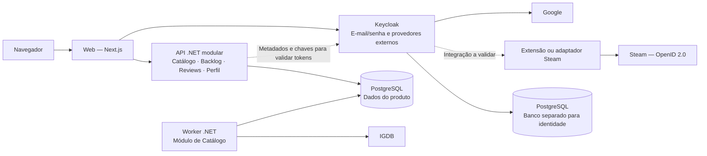

# ReviewVerse — arquitetura inicial da POC

Status: base de arquitetura aprovada em 19/10/2026. API .NET modular, Worker separado e PostgreSQL foram confirmados pelo autor, mantendo Next.js e Keycloak. Detalhes de módulos, acesso a dados, autenticação, implantação e dimensionamento continuam em definição. Nenhuma alteração de arquitetura foi aplicada ao código.

## Objetivo

Construir a POC web do Realm de Jogos com o ciclo de catálogo, conta, Backlog e publicação de Review, com interface em português e inglês desde a primeira entrega. O cadastro será aberto, e as Reviews terão marcação de spoilers. A implementação deve atender inicialmente uma base pequena de usuários e permitir crescimento. Templates, votos de utilidade, página Top 100, moderação administrativa de Reviews e contas e funcionalidades especializadas ficam para etapas posteriores.

O [roteiro da POC](plano-da-poc.md) organiza a sequência de implementação e validação dessa base.

Estão confirmados C#/.NET, Next.js, Keycloak com e-mail/senha e provedores Google e Steam, IGDB como fonte principal de Jogos e um Worker para popular o catálogo. O perfil tem apelido público único. O catálogo da POC terá busca por nome e filtros por gênero e plataforma. O teto inicial é de R$ 200/mês para hospedagem, banco e backups. A prioridade declarada é o menor custo financeiro.

A carga inicial utilizará 100 jogos distintos já lançados da IGDB, selecionados por popularidade. É elegível um jogo com lançamento já ocorrido em alguma plataforma a partir de 2025, mesmo que o lançamento original seja anterior. Cada jogo conta uma vez, independentemente das plataformas. Remakes e remasters terão páginas próprias; DLCs e expansões também entram na POC. A correspondência desses tipos e relacionamentos com os registros da IGDB será validada posteriormente. O perfil exige e-mail confirmado antes de adicionar jogos ao Backlog ou publicar Reviews, inclusive para quem entrar via Steam.

## Decisão de arquitetura

Adotar uma API .NET modular, mantendo o Worker como processo separado e usando PostgreSQL para persistência do produto. Essa API constitui um monólito modular: uma aplicação de backend com limites explícitos entre suas áreas de negócio. Propõe-se organizar os módulos em Catálogo, Backlog, Reviews e Perfil; seus contratos e estrutura de projetos ainda serão detalhados.

A decisão considera o escopo e o estágio do projeto. A documentação da Microsoft descreve a organização lógica de aplicações .NET em uma única unidade de implantação e sua expansão por instâncias. Essa referência apoia a opção; a organização concreta proposta abaixo é específica para o ReviewVerse. [Referência: arquiteturas de aplicações web .NET](https://learn.microsoft.com/en-us/dotnet/architecture/modern-web-apps-azure/common-web-application-architectures).

As setas representam dependências gerais. Sessão web, callbacks de autenticação e transporte de tokens serão detalhados no desenho do fluxo de login. Os dois bancos lógicos podem compartilhar uma instância PostgreSQL, com credenciais e migrações separadas; o dimensionamento físico depende da hospedagem.

## Responsabilidades propostas

| Componente | Responsabilidade |
| --- | --- |
| Web | Navegação pública, páginas de jogos, autenticação e interface do Backlog e das Reviews. |
| Módulo de Catálogo | Jogos, plataformas, relação entre ambos, identificação externa e operações administrativas. |
| Módulo de Backlog | Registros pessoais por jogo/plataforma, estados e coleções por Realm. |
| Módulo de Reviews | Uma avaliação por usuário/jogo/plataforma, nota, texto opcional e médias. |
| Módulo de Perfil | Identidade pública do usuário e associação ao identificador da conta no Keycloak. |
| Worker | Carga e atualização do catálogo, registro de progresso e retomada de falhas. |
| Keycloak | Autenticação e integração com os provedores externos escolhidos. |
| PostgreSQL | Persistência do produto e, em banco lógico separado, da identidade. |

A busca por nome e os filtros de gênero e plataforma pertencem ao módulo de Catálogo e devem retornar jogos agregados, sem duplicar resultados pelo número de plataformas. Paginação, índices e comparação de nomes serão detalhados na implementação. O escopo confirmado não exige um mecanismo externo de busca na POC.

A administração do catálogo será feita somente por API na POC, com operações autorizadas para administradores. Isso inclui a alimentação e as correções administrativas previstas; o acionamento manual do Worker também deve exigir essa autorização. Não haverá tela web própria de administração do catálogo nessa entrega.

PostgreSQL foi confirmado como banco do produto. A escolha considera os relacionamentos entre usuários, jogos, plataformas, coleções e avaliações. A instância já descrita no Compose atual atende ao Keycloak, não a uma implementação pronta da persistência do produto. Acesso a dados, schemas, migrações e implantação ainda serão detalhados.

O Worker executaria os casos de uso de importação do módulo de Catálogo e escreveria somente os dados desse módulo. Foram confirmados acionamento manual por administrador e agendamento diário. Por delegação do autor, o padrão será 04h no fuso `America/Sao_Paulo`, ajustável por configuração, com cron de cinco campos `0 4 * * *`. O agendador precisa receber o fuso explicitamente. O uso de Hangfire ainda será discutido. O .NET oferece suporte a processos de trabalho em segundo plano com Worker Services. [Referência: Worker Services](https://learn.microsoft.com/en-us/dotnet/core/extensions/workers).

A implementação deve coordenar acionamentos manuais e agendados para evitar importações concorrentes do mesmo recorte. Reexecutar uma carga deve atualizar os registros correspondentes sem duplicar jogos ou plataformas.

Após a carga inicial, o Worker deve atualizar registros existentes e adicionar novos jogos elegíveis. Os limites padrão são 100 atualizações e 100 adições por execução, manual ou agendada, independentes e configuráveis, contados por jogo agregado. Novas adições podem fazer o catálogo crescer além dos 100 jogos iniciais.

Os metadados confirmados para a página de jogo da POC são título, capa, sinopse, gêneros, desenvolvedora/publicadora, plataformas e datas de lançamento. Identificação externa, dados de sincronização e indicadores usados na seleção serão tratados como dados internos da integração.

Correções administrativas têm precedência sobre os valores da IGDB. Como proposta de implementação, armazenar o valor importado e a correção administrativa separadamente por campo: a apresentação usa a correção quando ela existir, e o Worker pode atualizar o valor de origem sem apagar a correção. Os demais campos continuam acompanhando a fonte. A interface para retirar uma correção e voltar ao valor importado ainda será detalhada.

Para a implementação, propõe-se separar a seleção dos candidatos à adição da fila de jogos já importados a atualizar. Novos candidatos seriam priorizados por popularidade, e atualizações pelos registros há mais tempo sem sincronização, evitando processar sempre os mesmos jogos. A perda de posição em popularidade não deve, por si só, remover um jogo do catálogo ou os registros pessoais associados.

Como proposta técnica inicial, avaliar o indicador “IGDB Visits” do PopScore para popularidade, com indicador configurável e desempate estável pelo identificador IGDB. A documentação oferece métricas distintas, incluindo visitas e intenção de jogar; a métrica escolhida precisa ser validada com a cobertura dos candidatos elegíveis. A integração deve filtrar pela elegibilidade e deduplicar por jogo antes de aplicar o limite de 100, consultando páginas adicionais quando necessário. [Referência: IGDB PopScore](https://api-docs.igdb.com/#popscore).

O filtro temporal de elegibilidade deve considerar um lançamento por plataforma entre 01/01/2025 e a data da execução. Não basta o jogo existir em uma plataforma antiga e ter somente uma data futura para outra plataforma. Jogos ainda não lançados ficam fora da importação inicial. Remakes e remasters devem preservar identidades próprias no produto; o mapeamento de tipos e relacionamentos da IGDB será validado em uma etapa posterior.

## Backlog, apresentação e Reviews

O catálogo mantém o jogo agregado e suas plataformas. Os registros pessoais mantêm plataforma, estado e avaliação independentes. A apresentação pessoal é agregada quando o usuário tem somente uma plataforma do jogo; quando possui mais de uma, distingue as versões. Ao adicionar outra plataforma, a nova entrada herda automaticamente as coleções já associadas ao jogo. A representação dessas associações e alterações posteriores entre versões ainda será detalhada.

A publicação de Review exige entrada no Backlog em Jogando, Concluído, Em espera ou Abandonei, além de e-mail confirmado. Quero jogar/To do bloqueia a publicação. A API deve validar essas condições com o estado da entrada correspondente ao usuário/jogo/plataforma. Retornar a Quero jogar deve remover a Review existente, mantendo a entrada no novo estado.

Uma Review poderá ser sinalizada pelo autor como contendo spoilers. Propõe-se persistir essa indicação junto à avaliação e ocultar somente o texto na interface até o leitor optar por abri-lo. A nota continua visível. A POC não inclui moderação de Reviews de terceiros ou bloqueio de contas por administradores; a autorização administrativa para alimentar e corrigir o catálogo permanece necessária.

Excluir uma entrada do Backlog também deve remover a Review vinculada e atualizar sua participação nas médias. A operação deve preservar entradas e Reviews de outras plataformas. Propõe-se coordenar essa exclusão pelos casos de uso dos módulos de Backlog e Reviews, mantendo seus contratos e evitando que um módulo escreva diretamente nas tabelas do outro. A estratégia de consistência da operação será detalhada na implementação.

## Precisão das notas e médias

Na POC, a nota individual da Review é um inteiro de 1 a 10. Em uma evolução com templates, a nota derivada das subnotas segue `ceil(média das subnotas × 2) / 2`, sem substituição manual quando houver subnotas preenchidas.

A média da comunidade é calculada sobre as Notas Gerais efetivas de todas as Reviews, com o mesmo peso para cada uma. Reviews do mesmo usuário em plataformas diferentes contam separadamente. Não se deve calcular a média geral como média das médias de plataformas com pesos iguais quando houver quantidades distintas de Reviews.

A média da comunidade mantém a precisão do cálculo para classificação. A interface trunca a exibição para duas casas decimais, sem arredondamento: 8,678 → 8,67. O truncamento ocorre antes da formatação no idioma da interface, sem alterar o valor usado para ordenar. A página Top 100 fica para uma etapa posterior à POC. A estratégia de persistir soma e contagem ou calcular a média na consulta será detalhada na implementação. Edições e exclusões de Reviews, incluindo as removidas por retorno a Quero jogar, devem ser refletidas no resultado.

## Internacionalização desde a POC

Português e inglês são requisitos da primeira interface. Como proposta de implementação, organizar textos por chaves e catálogos de tradução, incluindo estados do Backlog, ações, validações e mensagens dos fluxos de conta e Review. Estados e outros conceitos persistidos devem usar identificadores estáveis, independentes do idioma exibido.

Números e datas serão formatados no idioma escolhido sem modificar os valores usados nas regras de negócio. A média 8,67 em português corresponde a 8.67 em inglês. O fuso de agendamento do Worker continua explícito em `America/Sao_Paulo`, independente do idioma do usuário.

O idioma inicial será detectado pelo navegador, com fallback para inglês quando não houver compatibilidade. A troca manual deve estar disponível e a preferência será salva no perfil; a escolha explícita prevalece sobre a detecção automática. A persistência da preferência de visitantes sem conta será detalhada na implementação.

Títulos e sinopses usam traduções fornecidas pela IGDB quando disponíveis; caso contrário, a apresentação recorre ao conteúdo original. Como proposta de modelagem, separar o valor original dos textos por idioma e aplicar a precedência das correções administrativas por campo e idioma. Reviews permanecem no texto escrito pelo autor, sem serviço de tradução automática na POC.

Telas de autenticação e mensagens de e-mail devem ser consideradas no fluxo de localização; o comportamento será detalhado junto com a integração Keycloak e o envio de mensagens. A biblioteca de internacionalização e o desenho de rotas da web serão escolhidos na implementação. A cobertura efetiva das traduções da IGDB será validada com a seleção importada, sem presumir que todos os jogos tenham os dois idiomas.

## Identidade e limites entre módulos

Google e Steam foram confirmados como provedores iniciais. O Keycloak documenta integração com Google. O login web do Steam utiliza OpenID 2.0; seu identificador autenticado é o SteamID. [Referências: Keycloak](https://www.keycloak.org/docs/latest/server_admin/index.html#_identity_broker), [autenticação Steam](https://partner.steamgames.com/doc/features/auth#website).

O suporte direto a Steam consta como solicitação aberta no projeto Keycloak. Não deve ser tratado como simples configuração de um provedor OIDC padrão. A proposta é avaliar uma extensão compatível ou um adaptador que converta o fluxo Steam para OIDC, mantendo o Keycloak como emissor da identidade para a aplicação. [Referência: solicitação de integração Steam no Keycloak](https://github.com/keycloak/keycloak/issues/43849).

Antes de escolher a implementação, validar login, retorno ao site, associação da conta ao SteamID e compatibilidade com a versão de Keycloak adotada. O componente Steam no diagrama representa essa integração ainda a validar, não a escolha de um serviço ou pacote específico.

Propõe-se um identificador interno de perfil associado ao usuário autenticado. Senhas e credenciais dos provedores permanecem sob responsabilidade da solução de identidade. Operações pessoais devem usar a identidade autenticada, e alimentação administrativa do catálogo deve exigir a autorização correspondente.

Cadastro e login por e-mail/senha também fazem parte da POC, sob responsabilidade do Keycloak. O banco do produto mantém o perfil e o apelido público único, sem replicar as senhas. A unicidade do apelido deve ser garantida na persistência, além da validação da interface; a normalização e o fluxo para escolher um apelido após login externo serão detalhados na implementação.

O perfil exige e-mail em ambos os fluxos de login. Se o fluxo externo não fornecer esse dado, o cadastro deve solicitá-lo antes de ser concluído. A confirmação do endereço é obrigatória antes de adicionar jogos ao Backlog ou publicar Reviews. A implementação deve aplicar essa regra também na API, além da interface. O aproveitamento de confirmação feita pelo provedor, o envio de mensagens e os demais campos obrigatórios serão detalhados.

Se a mesma pessoa quiser usar Google e Steam na mesma conta, propõe-se associação explícita após autenticação, preservando um único perfil do produto. Login com Steam não implica importação de biblioteca: essa funcionalidade não faz parte do escopo confirmado.

“Realm” no domínio do ReviewVerse significa Jogos, Animes/Mangás ou Filmes/Séries. Isso é distinto de um realm do Keycloak, que organiza identidade. A proposta inicial é usar um realm de identidade para a aplicação em cada ambiente, sem criar um realm do Keycloak para cada reino de mídia.

Cada módulo é responsável por suas regras de negócio e seus dados. Operações entre módulos passam por contratos explícitos, e um módulo não escreve diretamente nas tabelas de outro, mesmo compartilhando implantação ou banco. Mudanças que atravessem módulos devem explicitar coordenação, consistência e tratamento de falhas no plano de execução. Esses princípios foram confirmados no [ADR-0007](../adr/0007-limites-de-modulos-e-evolucao-da-arquitetura.md), correspondente à constituição 0.8. Organização de tabelas, migrações e projetos continua em detalhamento. A base aprovada orientará uma futura revisão da estrutura de projetos existente; essa reorganização ainda não foi executada.

## Operação e crescimento

A prioridade de menor custo financeiro direciona a proposta para uma VPS única com os componentes em contêineres. A [comparação inicial de hospedagem](hospedagem-inicial.md) registra referências de preços e limites dessa estimativa. É uma proposta, sem contratação ou fornecedor aprovado.

Para dimensionamento, propõe-se avaliar uma máquina com 8 GB de RAM como ponto inicial para testes com Next.js, API, PostgreSQL, Keycloak, Worker e integração Steam. Essa capacidade é uma hipótese de engenharia e deve ser validada com medições. O Worker pode executar cargas em horários definidos; consumo de importação e de build deve entrar na medição. O preço final precisa incluir câmbio efetivo, impostos, backups e demais cobranças para permanecer dentro dos R$ 200/mês.

O alvo confirmado é de 10 usuários simultâneos no fluxo da POC. Essa é uma meta para validação, sem capacidade comprovada nesta etapa. Os testes devem representar navegação, busca, acesso ao Backlog e publicação de Reviews; o impacto da execução do Worker sobre esse fluxo também deve ser medido. A composição da carga e as metas de latência serão detalhadas na implementação.

Para a POC, propõe-se iniciar com logs, verificações de saúde, migrações controladas e backups com restauração verificada. O processo de importação deve tolerar repetição sem duplicar jogos e plataformas e permitir retomar uma carga interrompida.

O crescimento seria orientado por medições de uso, latência, consumo de recursos e duração das importações. API e Worker poderiam receber recursos separadamente. A replicação da API exigiria validar sessão, armazenamento e coordenação dos jobs. Extrair um módulo para um serviço independente continuaria possível, mas exigiria revisar seus contratos, transações e dados.

Para essa proposta de POC, gateway dedicado, mensageria, cache distribuído e mecanismo separado de analytics seriam avaliados conforme necessidades demonstradas. Sua presença no desenho histórico não os torna dependências obrigatórias da primeira entrega.

## Decisões em aberto

- Contratos dos módulos e detalhes de implementação da base aprovada.
- Representação das associações a coleções e sua edição entre plataformas; critérios de classificação em etapa posterior à POC.
- Implementação da preferência de idioma para visitantes e integração da localização com autenticação e e-mails.
- Implementação Steam, associação entre métodos de acesso e fluxo de apelido único.
- Sessão da aplicação web e fluxo completo de login.
- Dimensionamento e custo total da opção de menor custo dentro do teto confirmado de R$ 200/mês.
- Hospedagem, dimensionamento para o alvo de 10 usuários simultâneos e metas de latência e recuperação.
- Acesso a dados e organização definitiva dos projetos.
- Indicador de popularidade, prioridade das atualizações e representação das correções administrativas na sincronização com IGDB.
- Correspondência e relacionamentos de remakes, remasters, DLCs e expansões na IGDB e tratamento de jogos sem indicador de popularidade.
- Mecanismo de envio/confirmação de e-mail e seu custo dentro do orçamento.
